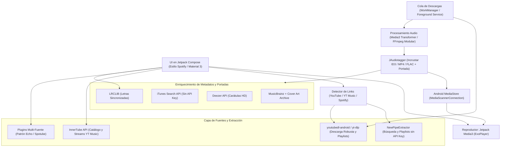

# 🎵 Investigación: Crear una App de Música Android Open-Source (Estilo Spotify)

> [!abstract] Resumen Ejecutivo
> No es necesario escribir la aplicación desde cero. El ecosistema FOSS (Free and Open Source Software) en Android cuenta con clientes maduros en **Kotlin + Jetpack Compose** (como **Metrolist**, **SimpMusic**, **Echo**, **Kreate** y **Spotube**) y motores de descarga probados (como **Seal**, **YTDLnis**, **Spowlo**, **NewPipeExtractor** y **yt-dlp**).
>
> La estrategia óptima es **combinar o bifurcar (fork) un reproductor existente con UI estilo Spotify/Material 3** (ej. *SimpMusic*, *Metrolist* o *Echo*) e integrar un **pipeline de descarga masiva y etiquetado automático** (inspirado en *YTDLnis* / *Seal* + *JAudiotagger* + APIs abiertas de portadas).

---

## 🎯 Mapeo de Requisitos vs. Soluciones Open-Source

| Requisito del Usuario | Cómo se resuelve con Open-Source | Proyectos / Librerías Clave |
| :--- | :--- | :--- |
| **1. Acceso a música de YouTube, Spotify, etc.** | Consultar el catálogo/metadatos de Spotify o YouTube Music y resolver el flujo de audio desde fuentes públicas (YouTube, Piped, SoundCloud, Bandcamp) mediante plugins o parsers internos. | `InnerTube`, `TeamNewPipe/NewPipeExtractor`, `Echo` (extensiones), `Spotube` (modelo híbrido), `SimpMusic`, `Metrolist` |
| **2. Descargar con 1 solo clic** | Cacheo directo del stream de audio (`ExoPlayer/Media3` Cache) o cola de descarga en segundo plano (`WorkManager`) extrayendo la pista de mayor bitrate (`.m4a`/`.opus`) y guardándola localmente. | `Seal`, `YTDLnis`, `youtubedl-android`, `Jetpack Media3` |
| **3. Imágenes de portada automáticas** | Búsqueda en cascada por título/artista/ISRC en APIs gratuitas sin API key compleja, descarga de carátula en alta resolución e incrustación dentro del archivo de audio (`.mp3`/`.m4a`/`.flac`). | `MusicBrainz + Cover Art Archive`, `iTunes Search API`, `Deezer API`, `JAudiotagger` |
| **4. Descargar playlists completas de YouTube con 1 link** | Parseo de URL de playlist (`youtube.com/playlist?list=...` o `music.youtube.com/...`) con `NewPipeExtractor` o `yt-dlp`, generación automática de cola paralela y conversión/etiquetado por lotes. | `yt-dlp` (`youtubedl-android`), `NewPipeExtractor`, `YTDLnis`, `Spowlo` (`spotDL`) |

---

## 🧩 1. Proyectos Base Candidatos (Para No Empezar de Cero)

En los últimos años, los pioneros originales (*ViMusic*, *InnerTune*, *OuterTune* y *RiMusic* —este último archivado a mediados de 2025—) cedieron el paso a sucesores y proyectos multi-fuente muy activos.

### A. Reproductores con Streaming + Descarga Offline

| Proyecto          | Repositorio GitHub                                                      | Stack Tecnológico                                                      | Licencia                                    | Puntos Fuertes                                                                                                                                                                                                        | Limitaciones a considerar                                                                                                                   |
| :---------------- | :---------------------------------------------------------------------- | :--------------------------------------------------------------------- | :------------------------------------------ | :-------------------------------------------------------------------------------------------------------------------------------------------------------------------------------------------------------------------- | :------------------------------------------------------------------------------------------------------------------------------------------ |
| **Metrolist**     | [MetrolistGroup/Metrolist](https://github.com/MetrolistGroup/Metrolist) | Kotlin, Jetpack Compose, KMP (Kotlin Multiplatform)                    | **GPL-3.0**                                 | Sucesor espiritual más activo de *InnerTune*. UI Material 3 Expressive, sincronización de cuenta YT Music, letras sincronizadas, descargas offline y multiplataforma (Android, iOS, Desktop).                         | Centrado principalmente en YouTube Music; no tiene soporte nativo de catálogo Spotify sin adaptarlo.                                        |
| **SimpMusic**     | [maxrave-dev/SimpMusic](https://github.com/maxrave-dev/SimpMusic)       | Kotlin, Jetpack Compose                                                | **GPL-3.0** *(verificar LICENSE del repo)*  | Interfaz limpia muy similar a **Spotify**, sin anuncios ni login obligatorio, SponsorBlock integrado, letras sincronizadas palabra por palabra (vía **LRCLIB**), descargas offline y Android Auto.                    | Enfocado en backend de YouTube Music; no está pensado como descargador masivo de archivos `.mp3` portables fuera de la app sin modificarlo. |
| **Echo**          | [brahmkshatriya/echo](https://github.com/brahmkshatriya/echo)           | Kotlin, Jetpack Compose, Material 3, Media3/ExoPlayer                  | **UPL** *(basada en GPLv3)*                 | **Arquitectura de extensiones multi-servicio**: integra YouTube Music y Spotify en una misma interfaz unificada, con letras sincronizadas y reconocimiento de audio.                                                  | La licencia UPL (Unabandon Public License) exige que cualquier derivado permanezca estrictamente abierto y accesible.                       |
| **Spotube**       | [team-spotube/spotube](https://github.com/team-spotube/spotube)         | Migrando de Flutter a Compose Multiplatform + plugins Kotlin (Zipline) | **AGPL-3.0-or-later**                       | **Modelo híbrido ideal para "estilo Spotify"**: usa Spotify para metadatos, playlists y biblioteca, pero reproduce el audio desde fuentes públicas (YouTube/Piped/JioSaavn) vía plugins. No requiere Spotify Premium. | Afectado por las restricciones de la API de Spotify (2024–2026) y la licencia AGPL-3.0 es muy restrictiva si planeas servicios en red.      |
| **Kreate**        | [knighthat/Kreate](https://github.com/knighthat/Kreate)                 | Kotlin (Android)                                                       | Open-source *(derivado de RiMusic/ViMusic)* | Reescrito desde cero tras *RiMusic*. Multi-fuente (YouTube Music, OpenSubsonic API, archivos locales), gestor robusto de cola de descargas, letras (LRCLIB, BetterLyrics), Android Auto.                              | Menor foco en estética idéntica a Spotify (más cercano a ViMusic/RiMusic).                                                                  |
| **Bloomee**       | [HemantKArya/BloomeeTunes](https://github.com/HemantKArya/BloomeeTunes) | Flutter                                                                | Open-source                                 | Sistema de plugins auto-actualizables (`.bex`) para múltiples fuentes, letras estilo karaoke, Last.fm scrobbling, ecualizador y recuperación de streams caídos.                                                       | Escrito en Flutter (Dart) en lugar de Kotlin nativo.                                                                                        |
| **Gyawun**        | [sheikhhaziq/gyawun_music](https://github.com/sheikhhaziq/gyawun_music) | Flutter                                                                | Open-source                                 | Cliente ligero de YouTube Music con Material You, descargas offline, podcasts, LRCLIB y ecualizador.                                                                                                                  | Escrito en Flutter; menor ecosistema nativo para librerías Android como `youtubedl-android`.                                                |
| **Harmony Music** | [anandnet/Harmony-Music](https://github.com/anandnet/Harmony-Music)     | Flutter                                                                | **GPLv3 + cláusulas extra**                 | Reproductor multiplataforma ligero.                                                                                                                                                                                   | Su licencia prohíbe explícitamente uso comercial y publicación en Google Play / App Store.                                                  |

### B. Descargadores Especializados (Referencia para 1-Click y Playlists)

| Proyecto | Repositorio GitHub | Stack | Licencia | Qué aprovechar de su código |
| :--- | :--- | :--- | :--- | :--- |
| **YTDLnis** | [deniscerri/ytdlnis](https://github.com/deniscerri/ytdlnis) | Kotlin, Jetpack Compose, `yt-dlp` | **GPL-3.0** | Su **arquitectura modular de paquetes** (separa FFmpeg, Python y NodeJS/Deno en módulos/APKs auxiliares en `jniLibs` para cumplir restricciones `W^X` de Android), gestión de colas de playlists y configuración de **PO Tokens**. |
| **Seal** | [JunkFood02/Seal](https://github.com/JunkFood02/Seal) | Kotlin, Jetpack Compose, `youtubedl-android` | **GPL-3.0** | Referencia de UI/UX Material 3 para descargas con un toque, extracción de audio de playlists con un enlace y plantillas de comandos `yt-dlp`. |
| **Spowlo** | [BobbyESP/Spowlo](https://github.com/BobbyESP/Spowlo) | Kotlin, Jetpack Compose, `spotDL` | Open-source (GPL-3.0) | Cómo envolver `spotDL` en Android para pegar un enlace de Spotify y descargar la canción o playlist emparejándola automáticamente con YouTube/YouTube Music. |

---

## 🏗️ 2. Arquitectura Técnica Recomendada

Para cumplir los 4 requisitos en un solo producto cohesivo sin reinventar la rueda, la arquitectura recomendada en **Kotlin + Jetpack Compose** sigue un flujo desacoplado por capas:

---

## 🔍 3. Análisis Profundo por Requisito

### Requisito 1: Acceso a toda la música (YouTube, Spotify, etc.)

#### Cómo funciona realmente
Ninguna app gratuita de código abierto "piratea" los servidores de audio DRM de Spotify. Lo que hacen es:
1. **Para YouTube y YouTube Music:** Consultan la API interna **InnerTube** o parsean páginas públicas con **NewPipeExtractor** (sin necesidad de claves de Google API).
2. **Para Spotify:** Usan Spotify únicamente como **base de datos de metadatos** (nombre de canción, artista, álbum, duración, portada, contenido de playlists) y buscan el equivalente de audio en YouTube Music, Piped, SoundCloud o Bandcamp.
3. **Arquitectura de Extensiones (Recomendada):** Inspirarse en **Echo** o **Spotube** para que cada plataforma sea un plugin independiente; si un servicio cambia su API, solo actualizas ese módulo.

> [!warning] Problemas Críticos en 2025–2026 que debes prever
> 1. **Restricciones de la API Web de Spotify (2024–2026):** Spotify bloqueó con errores `HTTP 403` endpoints clave para apps nuevas (*Audio Features*, *Audio Analysis*, *Recommendations*, *Related Artists*, *Featured Playlists*) y restringió el *Extended Quota Mode* exigiendo empresa registrada y un mínimo de **250,000 usuarios activos mensuales (MAU)**.
>    - **Solución:** No depender exclusivamente de la API oficial de Spotify para recomendaciones o descubrimiento. Usar **MusicBrainz**, **Last.fm API** (tags y artistas similares) y el grafo de recomendaciones de **YouTube Music (InnerTube)**. Para leer playlists de Spotify en `spotDL`/clientes, prever mecanismos de autenticación de usuario (`--user-auth`) o parsers públicos de respaldo.
> 2. **Bloqueos Anti-Bot de YouTube ("PO Token"):** YouTube exige **Proof of Origin (PO) Tokens** para clientes web/móviles; sin ellos, los streams sufren throttling (cortes a los 5–10 segundos) o errores `403`.
>    - **Solución:** Mantener actualizados los extractores (`NewPipeExtractor` / `InnerTube` / `yt-dlp`) y contemplar soporte para proveedores de PO Token (como `bgutil-ytdlp-pot-provider` o configuración manual estilo *YTDLnis*).

---

### Requisito 2: Descarga con un solo clic (1-Click Download)

En un reproductor estilo Spotify existen dos conceptos de "descarga" que conviene ofrecer o unificar:
1. **Offline dentro de la app (Caché de Media3):** Rápido, instantáneo y sin conversión. `ExoPlayer`/`Media3` descarga los segmentos `.opus` o `.m4a` mientras suena o al pulsar el botón de descarga y los reproduce sin internet desde la base de datos local (`Room`).
2. **Descarga como archivo real portable (`.mp3` / `.m4a` / `.flac`) en `/Music`:** Ideal para que el usuario tenga los archivos en su almacenamiento. Aquí es donde entra el flujo de **1 solo clic**:
   - Al pulsar `Descargar`, un `WorkManager` o `ForegroundService` toma el ID/URL de la pista.
   - Extrae el mejor stream de audio disponible (`bestaudio`).
   - Convierte o remuxea el contenedor si es necesario (ej. `.webm` → `.m4a` o `.mp3`).
   - Incrusta metadatos + portada y notifica al sistema con `MediaScannerConnection.scanFile()`.

> [!important] Retiro de `ffmpeg-kit` (Cambio clave en Android)
> La librería estándar histórica **`ffmpeg-kit` fue oficialmente archivada/retirada** debido a la complejidad de mantener compilaciones cruzadas para NDK modernos, Android 15 y el requisito de páginas de memoria de 16 KB.
>
> **Alternativas actuales para procesar audio en tu app:**
> - **Opción A (Más limpia y nativa):** **Jetpack Media3 `Transformer`** para transcodificación/remuxeo acelerado por hardware sin empaquetar binarios pesados de FFmpeg (siempre que no necesites comandos CLI complejos).
> - **Opción B (Modelo modular de YTDLnis):** Separar FFmpeg, Python (`yt-dlp`) y runtime JS en paquetes auxiliares / `.so` en `jniLibs` para cumplir con la seguridad `W^X` de Android y actualizarlos independientemente de la app principal.
> - **Opción C:** **FFmpegKitNext** (sucesor creado por el autor original) o compilación manual con NDK r27/r28 soportando páginas de 16 KB.
> - *Nota:* Si descargas `.m4a` (AAC) nativo de YouTube/YouTube Music, muchas veces **ni siquiera necesitas transcodificar**, evitando peso extra y pérdida de calidad.

---

### Requisito 3: Imágenes de portada automáticas (y metadatos limpios)

Las miniaturas de YouTube suelen ser rectangulares (`16:9`, 1280×720) con barras negras o texto de videoclip. Para que parezca Spotify, tu app debe obtener **portadas cuadradas oficiales de álbum** automáticamente.

#### Pipeline de enriquecimiento en cascada:
1. **Limpieza del título:** Antes de buscar, limpiar sufijos basura del título de YouTube (ej. `(Official Video)`, `[Lyrics]`, `4K Remastered`, `ft.`).
2. **Consulta a APIs gratuitas (sin complicaciones de claves comerciales):**
   - **iTunes Search API** *(Plan A por velocidad y simplicidad)*:
     - Sin API key.
     - Endpoint: `https://itunes.apple.com/search?term=ARTISTA+CANCION&entity=song` (o `album`).
     - Truco clave: La respuesta devuelve `artworkUrl100` (`...100x100bb.jpg`); reemplazando el texto en la URL por `600x600bb.jpg` (o superior) obtienes la carátula oficial cuadrada en HD.
   - **Deezer API** *(Plan B muy fiable)*:
     - Endpoint: `https://api.deezer.com/search/album?q=ARTISTA+ALBUM`
     - Imagen directa: `https://api.deezer.com/album/{id}/image?size=big` (o campo `cover_big` / `cover_medium`).
   - **MusicBrainz + Cover Art Archive** *(Plan C de máxima precisión enciclopédica)*:
     - Endpoint: `https://musicbrainz.org/ws/2/recording/?query=recording:"TITULO" AND artist:"ARTISTA"&fmt=json`
     - Con el `MBID` del release, pides la portada a: `https://coverartarchive.org/release/{MBID}/front`.
     - Opcional: **AcoustID** para identificación por huella acústica si el archivo no tiene nombre fiable.
3. **Incrustación en el archivo local:**
   - Usar **JAudiotagger** (vía JitPack para Android, ej. `com.github.Adonai:jaudiotagger-android`).
   - Escribir `ARTIST`, `ALBUM`, `TITLE`, `YEAR` y adjuntar el JPG/PNG descargado con `ArtworkFactory.createArtworkFromFile(artFile)` + `audioFile.commit()`.
   - Refrescar el índice de Android con `MediaScannerConnection.scanFile()` para que cualquier reproductor del teléfono muestre la portada inmediatamente.
4. **Bonus — Letras sincronizadas:** Consultar **LRCLIB** (`lrclib.net`) para mostrar letras sincronizadas al estilo Spotify sin coste alguno.

---

### Requisito 4: Descargar playlists completas de YouTube con solo un link

#### Flujo recomendado:
1. **Detección inteligente de URL:** Al pegar un link en el buscador o compartir desde la app oficial de YouTube (`Intent.ACTION_SEND`), detectar patrones:
   - `youtube.com/playlist?list=...`
   - `music.youtube.com/playlist?list=...`
   - `youtube.com/watch?v=...&list=...` (preguntar al usuario: *"¿Solo esta canción o toda la playlist?"*).
2. **Extracción rápida de la lista de canciones:**
   - Usar **NewPipeExtractor** (en Kotlin/Java puro, rapidísimo en móvil sin levantar Python) o **`yt-dlp --flat-playlist --dump-json`** (vía `youtubedl-android`) para obtener en segundos todos los títulos, autores, duraciones e IDs sin descargar todavía el audio.
3. **Previsualización y selección con 1 clic:**
   - Mostrar la lista de canciones detectadas con un botón maestro **"Descargar Playlist (N canciones)"** (y checkboxes por si quiere desmarcar alguna).
4. **Cola de descargas concurrente y resiliente:**
   - Gestionar la cola con **Android `WorkManager`** + base de datos local **Room** (estados: `PENDING`, `DOWNLOADING`, `TAGGING`, `COMPLETED`, `FAILED`).
   - Limitar concurrencia (ej. **2 a 3 descargas simultáneas**) para evitar bloqueos por rate-limit (`HTTP 429` / `403`) de YouTube y cuidar la batería.
   - Si una canción falla (video eliminado o privado), marcarla y continuar con el resto, permitiendo reintento selectivo.
   - Crear automáticamente una **playlist local** dentro de tu app (y opcionalmente exportar un archivo `.m3u`).

---

## 🛠️ 4. Stack Tecnológico Sugerido (Para Desarrollo en Kotlin)

- **Lenguaje:** Kotlin + Coroutines / Flow.
- **UI:** Jetpack Compose + Material 3 (Dynamic Color / Material You + tema oscuro estilo Spotify).
- **Reproducción de Audio:** Jetpack **Media3** (`ExoPlayer`, `MediaSessionService` para controles en pantalla de bloqueo y Android Auto).
- **Extracción y Descarga:**
  - *Streaming rápido:* `InnerTube` + `TeamNewPipe/NewPipeExtractor`.
  - *Descarga robusta de pistas y playlists:* `youtubedl-android` (`yt-dlp`) con estrategia modular para FFmpeg/JS runtime/PO Token.
- **Base de Datos y Colas:** `Room` (biblioteca, historial, playlists, cola de descargas) + `WorkManager`.
- **Red y Debugging:** `OkHttp` / `Retrofit` o `Ktor` + **Chucker** (inspector HTTP dentro de la app para depurar fallos de extractores o APIs desde el propio celular).
- **Etiquetado de Audio:** `JAudiotagger` + `Coil` (carga y caché de imágenes de portada).

---

## ⚖️ 5. Licencias, Legalidad y Distribución (Muy Importante)

> [!warning] Implicaciones de Licencias Open-Source (Copyleft)
> Casi todos los proyectos base mencionados (**Metrolist**, **SimpMusic**, **Seal**, **YTDLnis**, **ViMusic**) usan **GPL-3.0**, **Spotube** usa **AGPL-3.0-or-later** y **Echo** usa **UPL**.
> - **¿Qué significa esto?** Si modificas o tomas código de cualquiera de ellos, **tu aplicación también debe ser de código abierto** bajo la misma licencia compatible (no puedes hacer un fork cerrado/propietario ni vender código GPL sin liberar las fuentes).
> - Proyectos como *Harmony Music* además prohíben explícitamente subir derivados a Google Play o comercializarlos.

> [!caution] Políticas de Google Play Store
> Una aplicación que descarga audio de YouTube o reproduce YouTube en segundo plano sin anuncios **viola los Términos de Servicio de YouTube** y las políticas de Google Play. **Será rechazada o eliminada de la Play Store.**
>
> **Canales de distribución reales para este tipo de apps:**
> - **GitHub Releases** (con auto-actualizador dentro de la app, como hace *Metrolist*).
> - **F-Droid** o repositorios compatibles como **IzzyOnDroid** (requieren compilación reproducible y 100% libre de blobs propietarios).
> - **Obtainium** (muy popular entre usuarios Android para actualizar apps directamente desde GitHub).

---

## 🗺️ 6. Hoja de Ruta Recomendada (3 Caminos Posibles)

### Camino A: El más rápido (Fork de *SimpMusic* o *Metrolist*)
1. Clonar `maxrave-dev/SimpMusic` (si buscas UI más cercana a Spotify) o `MetrolistGroup/Metrolist` (si buscas el ecosistema más activo hoy en Kotlin/Material 3).
2. Añadir un módulo de **"Importar / Descargar por Link"** usando `NewPipeExtractor` o `youtubedl-android` para aceptar URLs de playlists de YouTube.
3. Añadir un servicio de **enriquecimiento de portadas** (`iTunes Search API` → `Deezer` → `MusicBrainz`) + `JAudiotagger` para exportar archivos `.m4a`/`.mp3` limpios a `/Music`.

### Camino B: Multi-plataforma y Multi-servicio (Basado en *Echo* o *Spotube*)
- Ideal si quieres integrar **Spotify + YouTube Music + SoundCloud** en un solo lugar desde el día 1.
- Requiere respetar estrictamente la licencia UPL (*Echo*) o AGPL-3.0 (*Spotube*) y lidiar con los límites recientes de la API de Spotify.

### Camino C: App Propia Modular (Usando librerías FOSS, sin fork gigante)
- Construir tu propia app limpia en **Kotlin + Jetpack Compose** reutilizando únicamente las piezas pesadas ya hechas:
  - `TeamNewPipe/NewPipeExtractor` (búsqueda + playlists)
  - `Jetpack Media3` (reproductor + caché)
  - `youtubedl-android` (descargas complejas)
  - `JAudiotagger` + APIs de portadas (`iTunes`/`Deezer`/`MusicBrainz`) + `LRCLIB` (letras).
- **Ventaja:** Código mucho más limpio y fácil de mantener para ti, eligiendo exactamente las dependencias que quieres sin heredar deuda técnica de otros forks.

---

## ✅ Próximos Pasos Sugeridos
- [ ] Elegir el enfoque principal: **Camino A (Fork de SimpMusic/Metrolist)** vs. **Camino C (App propia con NewPipeExtractor + Media3 + yt-dlp)**.
- [ ] Revisar los repositorios en GitHub (`MetrolistGroup/Metrolist`, `maxrave-dev/SimpMusic`, `deniscerri/ytdlnis`, `brahmkshatriya/echo`) y probar sus APKs en un dispositivo Android para validar UX.
- [ ] Definir el formato de descarga preferido por defecto (`.m4a` nativo sin transcodificar vs. `.mp3` universal con Media3 Transformer/FFmpeg).
- [ ] Montar un prototipo mínimo (MVP) con: Buscador → Reproductor Media3 → Botón 1-Click Download con portada de iTunes/Deezer → Parser de link de playlist de YouTube.
